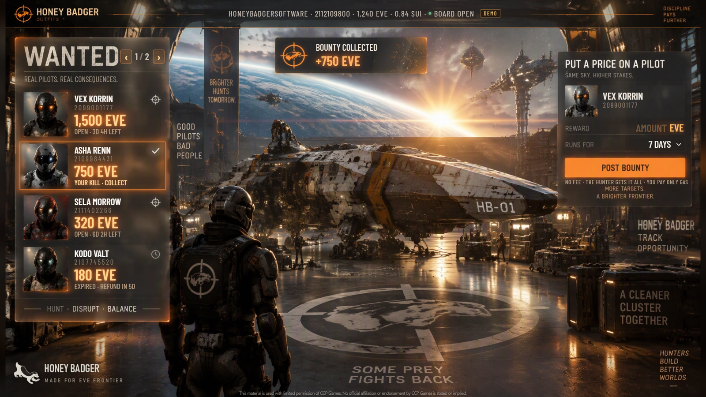
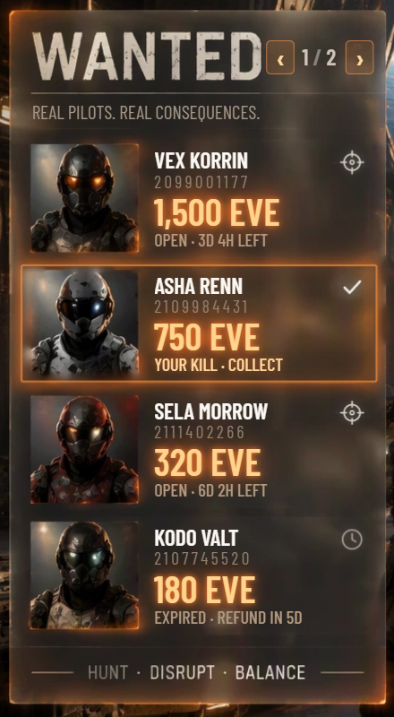
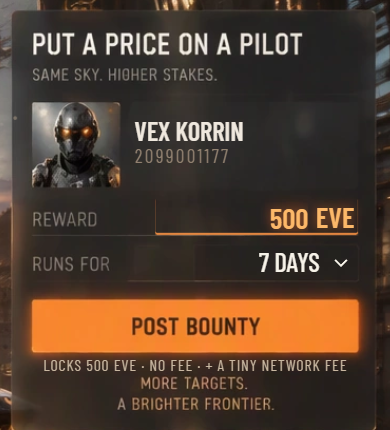
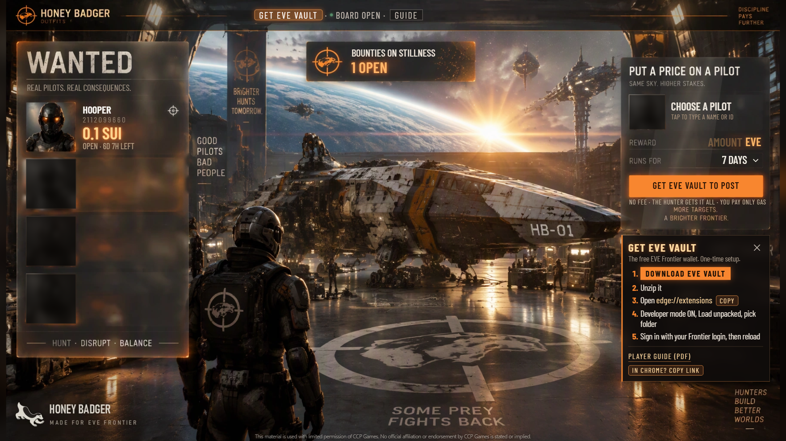

# Honey Badger Bounty Board for EVE Frontier

**Put a price on any pilot. Whoever gets the kill collects it, straight from the chain.**

**Open the board:** https://honeybadger.software/frontier/bounty/
**Player guide (PDF):** https://honeybadger.software/frontier/bounty/Honey-Badger-Bounty-Board-Guide.pdf

## How it works

- **Post a bounty.** Find any pilot by name, lock a reward in SUI or the game's EVE token, and pick how long it runs (1 to 14 days).
- **Collect it.** Destroy that pilot's ship before the time runs out. The game's own killmail on the chain is the proof, so COLLECT pays the whole reward straight to your wallet.
- **No fee, no middleman.** The hunter gets all of it. You only pay the small network fee.
- **Fair rules, enforced by the contract.** You can't put a bounty on yourself, and the target can't collect their own death.
- **Your coins are never stuck.** If nobody collects, the poster takes the reward back after a 7-day grace period for late killmails.

| Wanted | Put a price on a pilot |
|---|---|
|  |  |

## What you need

- A browser with **EVE Vault**, the EVE Frontier wallet (Chrome or Edge). The board walks you through getting it: one download, one-time setup.
- A pilot on **Stillness**, EVE Frontier's live server.

## For tool builders

Every bounty is a public object on Sui, so any killboard, map or bot can read them. Contract `hb_bounty`, module `bounty_board`, on the Stillness world (Sui testnet):

| | Cycle 7 (from 2026-09-29) | Cycle 6 |
|---|---|---|
| Package | `0xeb1679923137f370367cd01148cac14365a200ecf2e9d966f0646d9213bc7147` | `0x6405b8223e15a87e88788c4bdcfae119213f144dd00838044a6f4d0160a95bdb` |
| BoardConfig (shared) | `0xae92ca07ecdad35d7a41479b1d894534b3fa2d8c7a7fffb9f102fdbb58b0da2b` | `0x82c328be806a00cb8c44504eacbe3ce44007b3261baa4abf1f641e2268093cd0` |

Events to watch: `BountyPlacedEvent`, `BountyClaimedEvent`, `BountyRefundedEvent`.

**Contract source:** [`contract/`](contract/) holds the Move package exactly as published (`sources/bounty_board.move`,
its tests, `Move.toml` with the world pin, and the `Published.toml` records for both cycles). The rules the contract
enforces are written out at the top of `bounty_board.move`.

## Status

Live on Stillness. It runs on EVE Frontier's test world with test tokens, so nobody risks real money. Feedback and ideas are welcome: open an issue here.

---

Built by **Honey Badger Software Designs** (HONEYBADGERSOFTWARE in game) · [@HoneyBadgerMods](https://x.com/HoneyBadgerMods) · [honeybadger.software](https://honeybadger.software/)

*This material is used with limited permission of CCP Games. No official affiliation or endorsement by CCP Games is stated or implied.*
